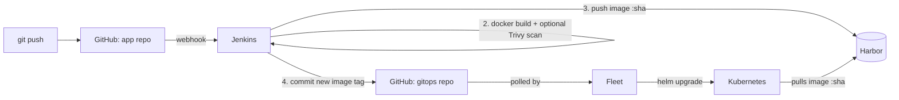

# CI/CD Lab: GitHub → Jenkins → Harbor → Fleet (Helm)

A minimal Spring Boot service used to demonstrate a GitOps delivery pipeline.
A `git push` to this repo ends with a new pod running in Kubernetes, with no manual step in between.

Companion repo with the Helm chart and Fleet config: **cicd-lab-gitops** (replace with your link).

## Flow



Design choices worth stating in an interview:

- **Jenkins never touches the cluster.** It only publishes an image and records the new tag in Git. Fleet (inside the cluster) pulls changes, so no cluster credentials live in CI.
- **Image tag = short git SHA, never `latest`.** Every deployment is traceable and a rollback is `git revert` on the GitOps repo.
- **Two repos.** Application code and deployment state change for different reasons and have different histories.
- Fleet detects changes by polling Git, not by listening to Harbor.

## Proof that a deployment came from a given commit

`GET /health` returns the commit the running image was built from:

```json
{"status":"UP","version":"a1b2c3d"}
```

The same short SHA appears in the Jenkins build, the Harbor tag, the GitOps commit message and this endpoint.

## Run it

Prerequisites: a Jenkins with JDK 17, Docker and Git on the agent; a Harbor project; a cluster running Fleet (Rancher or standalone).

1. **Maven wrapper (once, locally):** `mvn -N wrapper:wrapper`, then commit `mvnw` and `.mvn/`.
2. **Edit placeholders** in `Jenkinsfile` (`HARBOR_HOST`, `HARBOR_PROJECT`, `GITOPS_REPO`) and in the GitOps repo (`values.yaml`, `fleet/gitrepo.yaml`).
3. **Jenkins credentials** (Username with password): `harbor-creds` (Harbor robot account, push rights) and `gitops-creds` (GitHub user + PAT with write access to the GitOps repo).
4. **Jenkins job:** Pipeline from SCM pointing at this repo; enable the GitHub hook trigger.
5. **GitHub webhook:** payload URL `https://<jenkins-host>/github-webhook/`, event *push*. If Jenkins is not publicly reachable, expose it temporarily (ngrok/smee.io) or switch the trigger to `pollSCM`.
6. **Cluster, once:**
   ```bash
   kubectl create namespace demo
   kubectl -n demo create secret docker-registry harbor-regcred \
     --docker-server=<harbor-host> --docker-username=<robot> --docker-password=<token>
   kubectl apply -f fleet/gitrepo.yaml      # from the GitOps repo
   ```
7. Push a change and watch it roll out.

Optional DevSecOps stage: install `trivy` on the Jenkins agent and run the job with `RUN_TRIVY=true`; the build fails on CRITICAL vulnerabilities in the image.

## Evidence to capture (do this on a real run, then fill in the links)

Take these in one pass, in this order, and keep them in `docs/`:

1. GitHub → Settings → Webhooks → Recent Deliveries, status 200.
2. Jenkins build page with all stages green and the build duration.
3. Jenkins console showing `docker push` and the GitOps commit.
4. Harbor repository page with the new `:sha` tag.
5. GitOps repo commit list showing `ci: bump demo-app image tag to <sha>` authored by `jenkins-ci`.
6. Fleet / Rancher showing the GitRepo `Ready` and the bundle's Helm release.
7. `kubectl -n demo get pods` plus `curl .../health` returning the same SHA.
8. A deliberately failing build (break a test) showing the pipeline stops before the push.
9. A rollback: `git revert` on the GitOps repo and the previous version coming back.

A 60-90 second screen recording of steps 1 to 7 on a one-line change is the strongest single artifact. Hide passwords, tokens and internal IPs before publishing anything.

## Status

Pipeline run in progress: retrying after replacing the Docker Hub token (read-only scope).
