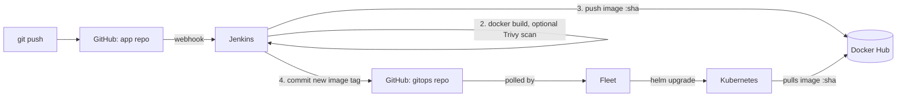

# CI/CD Lab: GitHub → Jenkins → Docker Hub → Fleet (Helm)

A minimal Spring Boot service used to demonstrate a GitOps delivery pipeline.
A `git push` to this repo ends with a new pod running in Kubernetes, with no manual step in between.

Companion repo with the Helm chart and Fleet config: [cicd-lab-gitops](https://github.com/kinmiya18/cicd-lab-gitops).

## Flow



Design choices worth stating in an interview:

- **Jenkins never touches the cluster.** It only publishes an image and records the new tag in Git. Fleet (inside the cluster) pulls changes, so no cluster credentials live in CI.
- **Image tag = short git SHA, never `latest`.** Every deployment is traceable and a rollback is `git revert` on the GitOps repo.
- **Two repos.** Application code and deployment state change for different reasons and have different histories.
- Fleet detects changes by polling Git, not by listening to the registry.

## Proof that a deployment came from a given commit

`GET /health` returns the commit the running image was built from:

```json
{"service":"demo-app","status":"UP","version":"1362c5d"}
```

The same short SHA appears in the Jenkins build, the Docker Hub tag, the GitOps commit message and this endpoint.

## Evidence from a real run

Recorded in [`docs/evidence/`](docs/evidence) on 2026-10-23/24:

| File | What it shows |
|---|---|
| `01-github-webhook-deliveries.txt` | GitHub push events delivered with HTTP 200 |
| `02-jenkins-build-3-stages.txt` | Successful build: Test, Docker build, Push, Bump tag in GitOps repo, with durations |
| `03-dockerhub-tags.txt` | Image tags published by the pipeline |
| `04-gitops-commits.txt` | `ci: bump demo-app image tag to <sha>` commits authored by `jenkins-ci` |
| `05-fleet-and-k8s.txt` | Fleet GitRepo ready, deployment and pod running the new tag |
| `06-health.txt` | `/health` returning the deployed commit SHA |
| `07-failing-build-stops-pipeline.txt` | A deliberately broken test: build fails at Test, no new image tag, no GitOps commit |
| `08-rollback.txt` | `git revert` in the GitOps repo and Fleet redeploying the previous tag |
| `09-trivy-scan.txt` | Trivy gate: 8 fixable CRITICAL CVEs blocked build 9; after upgrading Spring Boot, build 11 passed the scan and was deployed |

Run on: Jenkins 2.541.3, k3s v1.35.5 (k3d), Fleet chart 0.16.3, Docker Desktop on one laptop.

## Security gate (Trivy)

The `Image scan (Trivy)` stage scans the built image (OS packages and the Java libraries inside `app.jar`) and fails the build on any fixable CRITICAL vulnerability, before anything is pushed. It is switched on with the `RUN_TRIVY` build parameter.

On its first real run it blocked the build: Tomcat 10.1.31 and spring-webmvc 6.1.14, brought in by Spring Boot 3.3.5, carried 8 fixable CRITICAL CVEs. Upgrading to Spring Boot 4.0.9 fixed them, and the next scan passed. Details in `docs/evidence/09-trivy-scan.txt`.

The vulnerability databases are large, so the scan runs with a longer timeout and a persistent cache volume; the first scan downloaded them in about 7 minutes.

## Not covered yet

- Only dependency and image scanning is automated; there is no static code analysis (SonarQube) yet.
- The scan runs only when `RUN_TRIVY` is enabled, not on every build.
- Fleet detects changes by polling every 15 seconds; there is no registry-side trigger.
- The Docker Hub repository is public, so the cluster pulls without a secret.

## Run it

Prerequisites: a Jenkins with JDK 17, Docker and Git on the agent; a Docker Hub repository; a cluster running Fleet.

1. **Edit placeholders** in the `Jenkinsfile` (`DOCKERHUB_USER`, `GITOPS_REPO`) and in the GitOps repo (`values.yaml`, `fleet/gitrepo.yaml`).
2. **Jenkins credentials:**
   - `dockerhub-creds`: Username with password; Docker Hub username and an access token with Read & Write scope.
   - `gitops-deploy-key`: SSH private key whose public half is added to the GitOps repo as a deploy key with write access.
3. **Jenkins job:** Pipeline from SCM pointing at this repo; the `githubPush()` trigger is declared in the job.
4. **GitHub webhook:** payload URL `https://<jenkins-host>/github-webhook/`, event *push*. If Jenkins is not publicly reachable, relay through smee.io (`smee --url <channel> --target "http://localhost:8080/github-webhook/?src=smee"`; the query string stops smee-client from stripping the trailing slash, which would turn the POST into a 405).
5. **Cluster, once:** `kubectl apply -f fleet/gitrepo.yaml` (from the GitOps repo).
6. Push a change and watch it roll out.

Optional DevSecOps stage: run the job with `RUN_TRIVY=true`; it scans the image with the `aquasec/trivy` container and fails on fixable CRITICAL vulnerabilities.

## Lessons from the first run

- A Docker Hub token with read-only scope logs in successfully but fails the push with `insufficient scopes`.
- Re-delivering a webhook for a commit that was already built does not start a build; Jenkins sees no changes.
- Listing `valuesFiles` in `fleet.yaml` made Fleet render the chart without its default `service` values; relying on the chart's own `values.yaml` fixed it.
